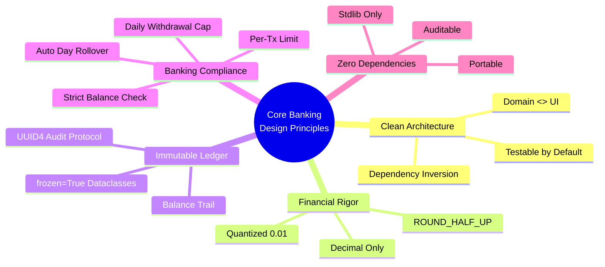

<!-- 
  ███████╗██████╗ ███████╗ ██████╗ ██████╗  ██████╗ ███╗   ██╗
  ██╔════╝██╔══██╗██╔════╝██╔═══██╗██╔══██╗██╔═══██╗████╗  ██║
  ███████╗██████╔╝█████╗  ██║   ██║██████╔╝██║   ██║██╔██╗ ██║
  ╚════██║██╔══██╗██╔══╝  ██║   ██║██╔══██╗██║   ██║██║╚██╗██║
  ███████║██║  ██║███████╗╚██████╔╝██║  ██║╚██████╔╝██║ ╚████║
  ╚══════╝╚═╝  ╚═╝══════╝ ╚═════╝ ╚═╝  ╚═╝ ╚═════╝ ╚═╝  ╚═══╝
  CORE BANKING SYSTEM • LEDGER IMUTÁVEL • COMPLIANCE BANCÁRIO
-->

<div align="center">


<br/>

[](https://www.python.org/)
[](#arquitetura-do-sistema)
[](#visão-executiva-e-dores-resolvidas)
[](#livro-razão-ledger-imutável)
[](#regras-de-negócio-e-compliance-bancário)
[-2EA44F?style=for-the-badge&logo=checkmarx&logoColor=white)](#execução-da-suíte-de-testes)
[-6366F1?style=for-the-badge)](#como-executar)
[](LICENSE)

<br/>

**Implementação corporativa de nível Core Banking** para o desafio **"Criando um Sistema Bancário com Python"** (Bootcamp Santander 2025 — Back-End com Python / DIO). Projetado com **Arquitetura Limpa (Clean Architecture)**, aritmética monetária exata (`decimal.Decimal`), **Livro-Razão (Ledger) imutável** com trilha de auditoria completa (UUID4 protocolo 8-char) e cobertura automatizada de regras de compliance bancário.

</div>

---

## 🎯 Visão Executiva e Dores Resolvidas

Em instituições financeiras reais, scripts monolíticos misturando interface com lógica de saldo geram **alto risco operacional**, **inconsistências contábeis** e **impossibilidade de auditoria**. Esta solução ataca diretamente **quatro dores críticas** de sistemas financeiros:

<details>
<summary><strong>📋 Clique para expandir a tabela comparativa completa</strong></summary>

| ⚠️ Dor Real em Sistemas Financeiros | ✅ Solução Implementada no Core Banking |
| :--- | :--- |
| **Deriva de centavos com `float`** (`0.1 + 0.2 != 0.3`) | Uso exclusivo de `decimal.Decimal` quantizado em `0.01` com arredondamento **`ROUND_HALF_UP`** (padrão contábil/bancário internacional). |
| **Falta de rastreabilidade contábil** | **Ledger (Livro-Razão) imutável** (`@dataclass(frozen=True)`) que registra cada operação com protocolo único `UUID4` (8 chars), carimbo `ISO 8601` / `BR`, valor, saldo anterior e saldo posterior. |
| **Violação de regras de risco e compliance** | Motor transacional valida, antes de qualquer débito: integridade numérica (`> R$ 0,00`), cota de **3 saques diários** com reset automático na virada do dia, teto de **R$ 500,00 por saque** e saldo disponível estrito. |
| **Acoplamento entre regras e canal de atendimento** | Separação rigorosa entre `Domain (Core Banking Ledger)` e `UI (CLI)`, permitindo plugar facilmente uma API REST (FastAPI/Django), mensageria ou banco de dados sem alterar o domínio. |

</details>

---

## 🏗️ Arquitetura do Sistema

<div align="center">

```mermaid
flowchart TB
    subgraph ENTRY["🚀 ENTRYPOINT"]
        M["main.py\nInicializa CoreBankingLedger\ninjeta dependências na UI"]
    end

    subgraph UI["🖥️ UI LAYER — src/ui/cli.py"]
        CLI["BankingCLI\n• Terminal corporativo box-drawing\n• Input resiliente (inválidos, Ctrl+C, EOF)\n• Comprovantes com protocolo UUID4\n• Alertas tipados de compliance\n• ZERO regra de negócio financeira"]
    end

    subgraph DOMAIN["🏦 DOMAIN LAYER — src/domain/"]
        LEDGER["ledger.py — CoreBankingLedger\n• TransactionRecord (frozen/imutável)\n• StatementSummary (frozen/imutável)\n• Decimal + ROUND_HALF_UP\n• Controle diário por data real\n• Extrato auditável padrão BRL"]
        EXC["exceptions.py — BankDomainError\n• ValorInvalidoError (ERR_VALOR_INVALIDO)\n• SaldoInsuficienteError (ERR_SALDO_INSUFICIENTE)\n• LimiteSaqueExcedidoError (ERR_LIMITE_SAQUE_EXCEDIDO)\n• LimiteDiarioAtingidoError (ERR_LIMITE_DIARIO_ATINGIDO)"]
    end

    subgraph TESTS["🧪 TESTS LAYER — tests/test_ledger.py"]
        TST["Suíte unittest nativa\n• Precisão Decimal\n• Bloqueios de risco\n• Imutabilidade Ledger\n• Virada de dia (FakeClock)\n• Fluxo CLI resiliente"]
    end

    M -->|instancia & injeta| CLI
    CLI -->|chama depositar()<br/>sacar()<br/>gerar_extrato()| LEDGER
    LEDGER -.->|usa exceções<br/>tipadas| EXC
    TST -.->|valida invariantes,<br/>compliance & FakeClock| LEDGER
    TST -.->|testa resiliência<br/>input loop| CLI

    classDef entry fill:#0f172a,stroke:#0ea5e9,stroke-width:2px,color:#fff;
    classDef ui fill:#0f172a,stroke:#10b981,stroke-width:2px,color:#fff;
    classDef domain fill:#0f172a,stroke:#fbbf24,stroke-width:2px,color:#fff;
    classDef test fill:#0f172a,stroke:#a855f7,stroke-width:2px,color:#fff;
    class M entry;
    class CLI ui;
    class LEDGER,EXC domain;
    class TST test;
```

</div>

---

## 📁 Estrutura do Projeto

```text
sistema-bancario-python/
├── main.py                      # Ponto de entrada da aplicação CLI
├── README.md                    # Documentação executiva e arquitetural
├── LICENSE                      # Licença MIT
├── .gitignore                   # Padrão Python
├── assets/
│   └── banner.svg               # Banner 3D isométrico (tema bancário)
├── src/
│   ├── __init__.py
│   ├── domain/
│   │   ├── __init__.py
│   │   ├── exceptions.py        # Exceções de domínio tipadas e códigos de erro
│   │   └── ledger.py            # Motor financeiro Decimal, compliance e Ledger imutável
│   └── ui/
│       ├── __init__.py
│       └── cli.py               # Terminal interativo resiliente com box-drawing
└── tests/
    ├── __init__.py
    └── test_ledger.py           # Suíte completa de testes unitários (unittest)
```

---

## 📋 Regras de Negócio e Compliance Bancário

<details>
<summary><strong>🔍 Clique para expandir tabela completa de compliance</strong></summary>

| Operação / Regra | Política Aplicada | Exceção / Código de Auditoria |
| :--- | :--- | :--- |
| **Depósito** | Aceita apenas valores estritamente positivos (`> R$ 0,00`), em formato BR (`1.250,50`) ou ISO (`1250.50`). | `ValorInvalidoError` (`ERR_VALOR_INVALIDO`) |
| **Teto por Saque** | Limite máximo de **R$ 500,00** por transação individual. | `LimiteSaqueExcedidoError` (`ERR_LIMITE_SAQUE_EXCEDIDO`) |
| **Cota Diária de Saques** | Máximo de **3 saques por dia**, calculado pela data corrente do relógio (reset automático à meia-noite). | `LimiteDiarioAtingidoError` (`ERR_LIMITE_DIARIO_ATINGIDO`) |
| **Verificação de Saldo** | Validação rigorosa de fundos disponíveis antes de efetuar qualquer débito. | `SaldoInsuficienteError` (`ERR_SALDO_INSUFICIENTE`) |
| **Extrato Auditável** | Exibe cabeçalho institucional, emissão (BR/ISO), protocolos `UUID4`, histórico de lançamentos, totais do período e saldo consolidado (`R$ 1.250,00`). | Consistência garantida por `Decimal` e `TransactionRecord` imutável |

</details>

---

## 🚀 Como Executar

### Pré-requisitos
- **Python 3.10+** (utiliza exclusivamente a biblioteca padrão do Python — **zero dependências externas**).

### Iniciar o Terminal Bancário
```bash
python main.py
```

### Execução da Suíte de Testes
```bash
python -m unittest discover -s tests -v
```

> **Nota**: A suíte roda 100% com `unittest` nativo — sem `pytest`, `mock` ou dependências de terceiros.

---

## 📊 Exemplo de Extrato Bancário Auditável

```text
╔════════════════════════════════════════════════════════════════════════════╗
║              EXTRATO BANCÁRIO AUDITÁVEL — CORE BANKING LEDGER              ║
╠════════════════════════════════════════════════════════════════════════════╣
║ Titular: Cliente Santander DIO | Ag: 0001 | Conta: 00012345-6              ║
║ Emissão: 15/08/2025 14:15:00 (2025-08-15T14:15:00)                         ║
╠────────────────────────────────────────────────────────────────────────────╣
║ PROTOCOLO  DATA/HORA           OPERAÇÃO            VALOR        SALDO PÓS  ║
╟────────────────────────────────────────────────────────────────────────────╢
║ 4F8A1C9E   15/08/2025 14:00:00 DEPÓSITO     +R$ 1.500,00      R$ 1.500,00  ║
║ 9B2E7D10   15/08/2025 14:15:00 SAQUE          -R$ 250,00      R$ 1.250,00  ║
╠────────────────────────────────────────────────────────────────────────────╣
║ Total de Entradas (Depósitos): R$ 1.500,00                                 ║
║ Total de Saídas (Saques):      R$ 250,00                                   ║
║ Cota Diária de Saques:         1/3 (Limite/transação: R$ 500,00)           ║
╠════════════════════════════════════════════════════════════════════════════╣
║ SALDO CONSOLIDADO ATUAL:       R$ 1.250,00                                 ║
╚════════════════════════════════════════════════════════════════════════════╝
```

---

## 🎯 Funcionalidades do CLI

| Comando | Atalho | Descrição |
| :--- | :---: | :--- |
| **Depositar** | `1` ou `D` | Crédito com validação monetária BR/ISO e comprovante UUID4 |
| **Sacar** | `2` ou `S` | Débito com compliance completo (teto, cota diária, saldo) |
| **Extrato** | `3` ou `E` | Emissão auditável completa com protocolos e totais |
| **Saldo/Limites** | `4` ou `C` | Posição consolidada + saques restantes hoje |
| **Sair** | `0` ou `Q` | Encerramento seguro da sessão |

> **Resiliência**: O loop de entrada trata `EOFError`, `KeyboardInterrupt`, strings não numéricas, booleanos, `NaN`, `Infinity` e formatos inválidos — **nunca quebra**.

---

## 🧪 Cobertura de Testes

<details>
<summary><strong>📋 Detalhes da suíte (5 classes de teste)</strong></summary>

| Classe de Teste | Foco | Casos Principais |
| :--- | :--- | :--- |
| `TestPrecisaoMonetariaEFormatacao` | Integridade financeira | `float` drift, `ROUND_HALF_UP`, formatação BRL, parsers BR/ISO |
| `TestDepositoEValidacoes` | Crédito & bloqueios | Depósito válido, zero/negativo, não-numérico, boolean, NaN, Infinity |
| `TestSaqueEComplianceBancario` | Saque & compliance | Saque válido, teto R$500, saldo insuficiente, 4º saque bloqueado, **reset dia seguinte** |
| `TestLedgerImutabilidadeEExtrato` | Imutabilidade & auditoria | `FrozenInstanceError`, `tuple` imutável, extrato vazio, consistência saldos |
| `TestResilienciaCLI` | CLI stress test | Fluxo completo com entradas inválidas, erros de compliance, cancelamentos |

</details>

```bash
# Execução rápida
python -m unittest discover -s tests -v
```

---

## 🛡️ Princípios de Design

<div align="center">



</div>

---

## 👨‍💻 Autor

Desenvolvido por **Lucas** ([@lcszero44-cell](https://github.com/lcszero44-cell)) como projeto de portfólio para o **Bootcamp Santander 2025 — Back-End com Python (DIO)**.

---

<div align="center">

[](https://github.com/lcszero44-cell)
[](https://linkedin.com/in/lucas-silva-zero)

**⭐ Se este projeto foi útil, deixe uma estrela no repositório!**

</div>